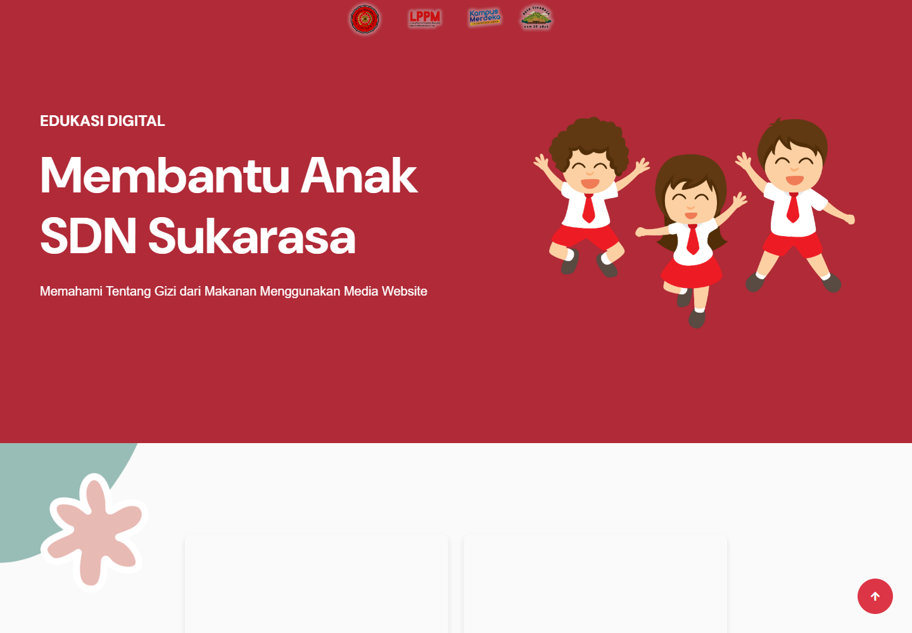
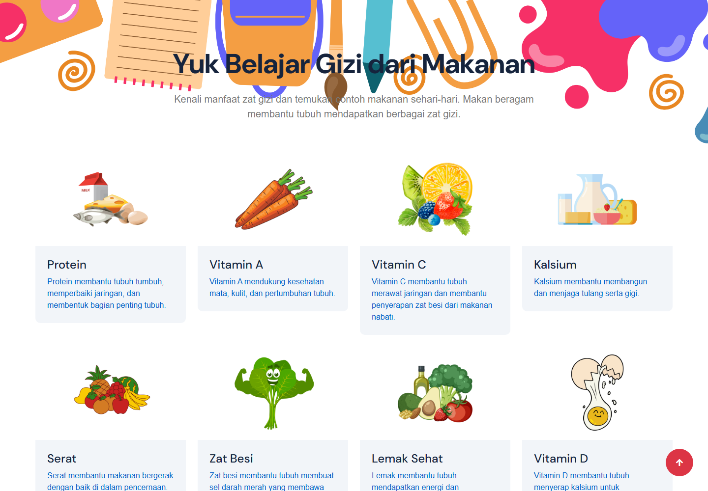
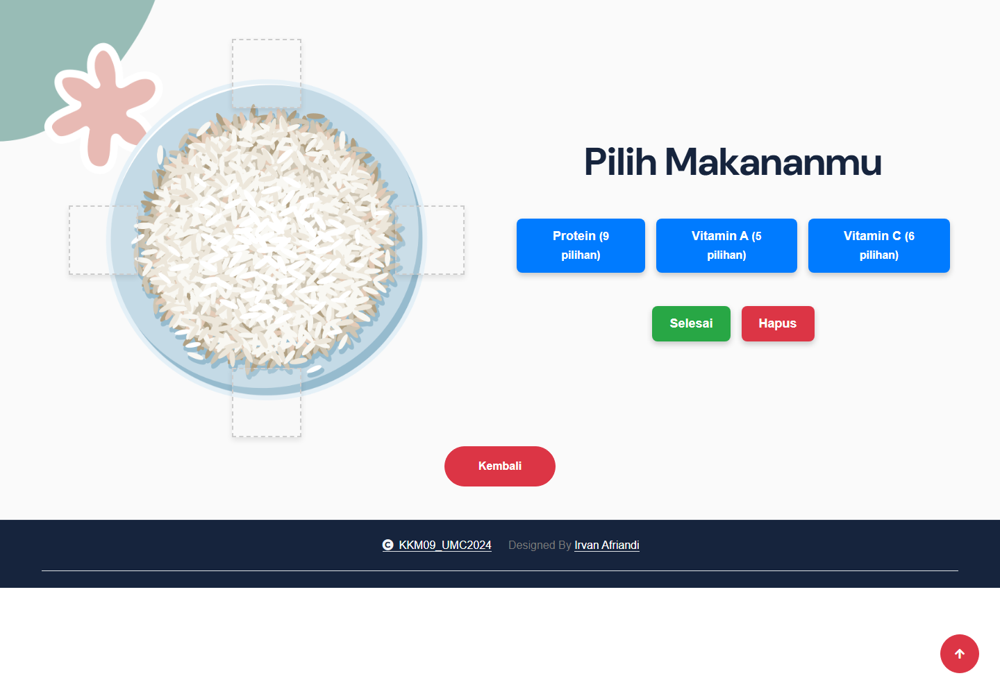
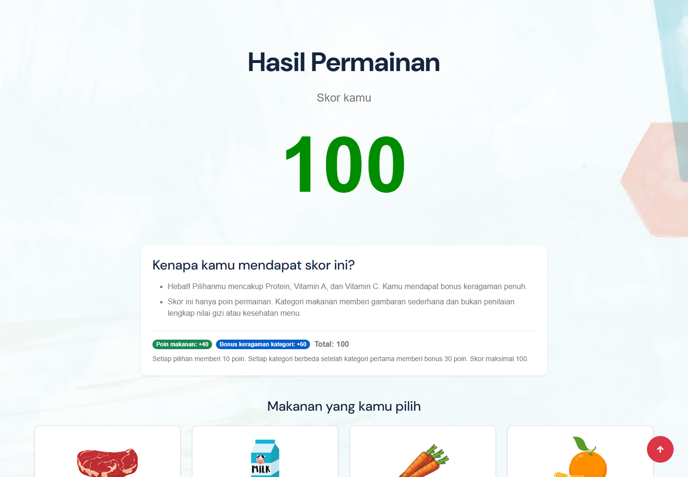

# Edukasi Gizi Anak SD

<p align="center">
  Website edukasi interaktif untuk membantu anak mengenal gizi dari makanan sehari-hari.
</p>

<p align="center">
  
  
  
</p>

Project KKM untuk membantu siswa SDN Sukarasa belajar tentang manfaat zat gizi dengan cara yang mudah dipahami. Pengguna dapat membaca materi singkat dan menyusun menu dari pilihan makanan untuk melihat hasil permainan beserta penjelasan skornya.

## Fitur

- **Materi edukasi:** delapan topik, yaitu Protein, Vitamin A, Vitamin C, Kalsium, Serat, Zat Besi, Lemak Sehat, dan Vitamin D.
- **Permainan susun menu:** pilih empat makanan dari kategori Protein, Vitamin A, dan Vitamin C.
- **Skor dan umpan balik:** hasil menjelaskan poin makanan dan bonus keragaman kategori.
- **Tampilan ramah anak:** ilustrasi makanan dan placeholder yang informatif jika gambar makanan belum tersedia.

## Tampilan dan cara penggunaan

### 1. Mulai dari beranda

Pilih **Edukasi** untuk membaca materi atau **Permainan** untuk mulai menyusun menu.

<p align="center">
  
</p>

### 2. Pelajari materi gizi

Buka salah satu topik untuk mengenal manfaat zat gizi dan contoh makanan sehari-hari.

<p align="center">
  
</p>

### 3. Susun menu permainan

Pilih kategori makanan, lalu pilih makanan dari jendela pilihan yang muncul. Ulangi hingga ada **empat makanan berbeda** di piring. Tekan **Selesai** untuk melihat hasil, atau **Hapus** untuk mengosongkan pilihan.

<p align="center">
  
</p>

### 4. Lihat skor dan penjelasannya

Skor dihitung kembali oleh server dari makanan yang dipilih. Hasil juga menunjukkan alasan skor dan kategori yang sudah tercakup.

<p align="center">
  
</p>

### Aturan skor

| Komponen | Poin |
| --- | ---: |
| Setiap makanan (empat pilihan) | 10 poin |
| Setiap kategori berbeda setelah kategori pertama | 30 poin |
| Skor maksimum | **100 poin** |

Skor 100 tercapai jika empat makanan yang dipilih mencakup ketiga kategori. Skor ini adalah **poin permainan**, bukan penilaian lengkap atas kandungan gizi atau kesehatan suatu menu.

## Menjalankan project

### Persyaratan

- PHP 8.1 atau lebih baru
- Composer
- MySQL atau MariaDB (tersedia melalui XAMPP)

### Instalasi

1. Clone repository dan masuk ke folder project.
2. Pasang dependency PHP dan salin konfigurasi environment:

   ```powershell
   composer install
   Copy-Item .env.example .env
   ```

3. Buat database MySQL bernama `kkm_individu` melalui phpMyAdmin atau jalankan:

   ```sql
   CREATE DATABASE kkm_individu CHARACTER SET utf8mb4 COLLATE utf8mb4_unicode_ci;
   ```

4. Sesuaikan pengaturan `DB_*` di `.env` dengan koneksi MySQL lokal. Contoh untuk XAMPP dengan konfigurasi default:

   ```dotenv
   DB_CONNECTION=mysql
   DB_HOST=127.0.0.1
   DB_PORT=3306
   DB_DATABASE=kkm_individu
   DB_USERNAME=root
   DB_PASSWORD=
   ```

5. Buat application key, jalankan migrasi, dan isi pilihan makanan:

   ```powershell
   php artisan key:generate
   php artisan migrate --seed
   ```

6. Jalankan server lokal:

   ```powershell
   php artisan serve
   ```

7. Buka alamat yang ditampilkan, biasanya <http://127.0.0.1:8000>.

### Gambar makanan

Beberapa gambar masih menunggu untuk ditambahkan. Aplikasi akan menampilkan placeholder sampai file berikut tersedia di `public/src/img/`:

- `tempe.png`
- `tahu.png`
- `kacang_hijau.png`
- `ubi_jalar.png`
- `jambu_biji.png`

## Menjalankan tes

```powershell
php artisan test
```

## Teknologi

- [Laravel 10](https://laravel.com/docs/10.x)
- PHP
- MySQL / MariaDB
- Blade, HTML, CSS, dan JavaScript
